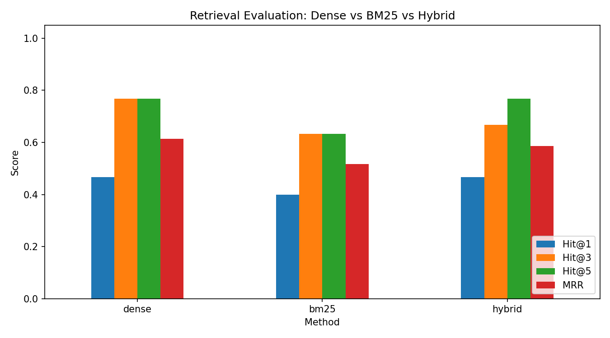

# 🤖 RAG PDF Chatbot (Hybrid Retrieval + Evaluation)

[](https://colab.research.google.com/github/LaibaSarwar712/rag-pdf-chatbot/blob/main/RAG_PDF_Chatbot.ipynb)

Ask questions about any PDF and get answers grounded in the document, with page citations. Built with open-source models only (no API keys), runs on a free Colab T4 GPU.

## Architecture
```
PDF -> text per page -> chunks (180 words, 40 overlap)
                              |
        +---------------------+---------------------+
        |                                           |
 Dense embeddings (multilingual-e5-small) + FAISS   BM25 (keywords)
        |                                           |
        +-------- Reciprocal Rank Fusion (hybrid) --+
                              |
                    Top-k chunks as context
                              |
              Qwen2.5-1.5B-Instruct -> answer + page citations
```

## Features
- Multilingual retrieval (English + Urdu questions)
- Three retrieval modes: dense, BM25, hybrid (RRF)
- Grounded answers: the model refuses when the answer is not in the document
- Retrieval evaluation with Hit@k and MRR on LLM-generated questions
- Gradio web demo

## Evaluation results
| Method | Hit@1 | Hit@3 | Hit@5 | MRR |
|---|---|---|---|---|
dense	| 0.467 |	0.767 |	0.767	| 0.613 |
bm25	| 0.400 |	0.633 |	0.633 |	0.517 |
hybrid	| 0.467 |	0.667 |	0.767 |	0.586 |

**Observations**
- Dense retrieval performed best (MRR 0.613), followed by hybrid (0.586) and BM25 (0.517).
- Hybrid (RRF) did not outperform dense retrieval on this document. A possible reason is that BM25 is weaker here and adds noise when fused with equal weight.
- Evaluation used only 30 synthetic questions on a single PDF, so differences between methods are small and should not be over-interpreted.
- Future work: weighted fusion, a cross-encoder reranker, and evaluation on multiple documents.




## Limitations
- Evaluation questions are synthetic (generated from the chunks), which favours keyword matching.
- A 1.5B-parameter LLM can make mistakes on complex questions; Urdu generation is limited.
- Scanned PDFs need OCR (not included).

## Future work
Cross-encoder reranking, OCR, multi-document support, faithfulness evaluation (RAGAS), larger quantized LLM.

## Run it
Click the Colab badge, select **T4 GPU**, then **Runtime → Run all**.
